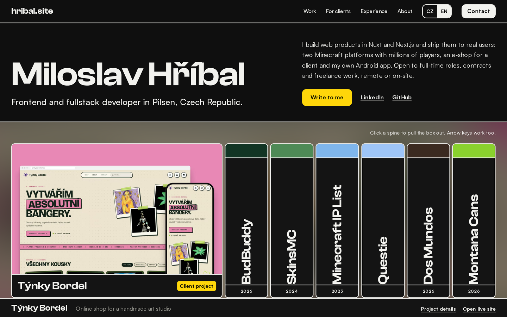

<div align="center">

# Portfolio

Personal portfolio of Miloslav Hříbal, frontend / fullstack developer.

[](https://nextjs.org)
[](https://react.dev)
[](https://www.typescriptlang.org)
[](https://tailwindcss.com)
[](https://posthog.com)
[](https://www.docker.com)

**[Live site: hribal.site](https://hribal.site)**



</div>

## About

A single-page portfolio built with the Next.js App Router. It presents my experience and projects and has a working contact form that delivers messages by email. It ships as a Docker image built by GitHub Actions.

## Features

- Hero with a project shelf: each project is a CSS 3D box that turns face-out when you click its spine (keyboard: arrow keys, Enter)
- Project pages-in-a-page with a spec table per project; covers in `public/covers/` are composited from live-site screenshots by `docs/cover-generator.cjs`
- Czech / English language toggle (detected from `Accept-Language`, remembered in a cookie)
- Contact form API route that sends email via Nodemailer, with SMTP fallbacks and local `sendmail`
- Showcase page with a before/after café website redesign (`/ukazky/dos-mundos`)
- Generated Open Graph image, sitemap and robots.txt
- PostHog analytics on client and server, proxied through `/ingest`

## Tech stack

| Area      | Tools                                         |
| --------- | --------------------------------------------- |
| Framework | Next.js 16 (App Router, standalone output), React 19 |
| Styling   | Tailwind CSS v4, Clash Display + Satoshi (Fontshare, self-hosted) |
| Backend   | Next.js route handler, Nodemailer             |
| Analytics | PostHog (`posthog-js`, `posthog-node`)        |
| Delivery  | Docker multi-stage build, GitHub Actions → GHCR |

## Getting started

Requires Node.js 20+ and pnpm.

```bash
pnpm install
pnpm dev        # http://localhost:3000
```

Other scripts: `pnpm build`, `pnpm start`, `pnpm lint`.

The contact form and analytics read their config from `.env.local`: `SMTP_HOST`, `SMTP_PORT`, `SMTP_USER`, `SMTP_PASS`, `NEXT_PUBLIC_POSTHOG_KEY`, `NEXT_PUBLIC_POSTHOG_HOST`.

### Docker

```bash
docker build -t portfolio .
docker run -p 3000:3000 --env-file .env.local portfolio
```

## Project structure

```
app/
  page.tsx               main page
  api/contact/route.ts   contact form endpoint
  ukazky/dos-mundos/     redesign showcase
components/              UI sections (Hero, Shelf, Projects, Contact, ...)
lib/                     i18n, project data, language context, PostHog clients
public/                  images, sitemap, robots.txt
```
